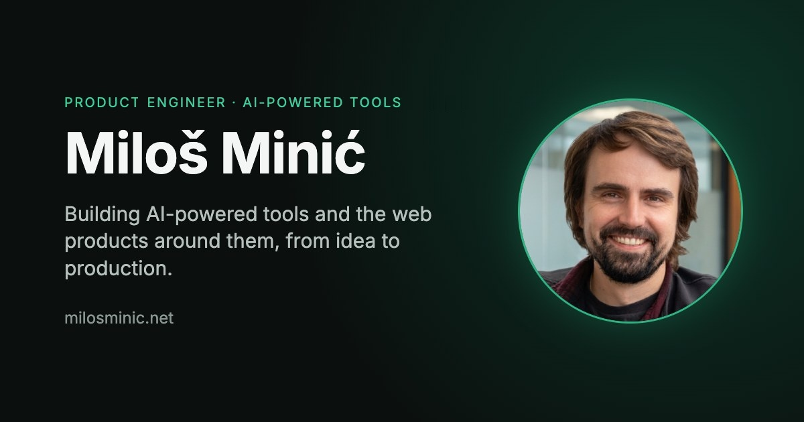

<!--  -->

# portfolio-showcase

A high-performance personal portfolio website built with Next.js 14 App Router, React, TypeScript, and Tailwind CSS.
Positioning: **Product Engineer** building AI-powered tools and modern web applications.

Live at: [https://www.milosminic.net](https://www.milosminic.net)

---

## Performance & Quality Benchmarks

### Lighthouse Scores (Simulated Mobile Runs on Production Build)

Audited via simulated mobile runs on a production build (`next build && next start` with throttled 4x CPU, mobile network profile) comparing pre-optimization baseline against current results:

| Category / Metric | Baseline (Pre-Phase 1) | Phase 4 Final | Current | Improvement |
| :--- | :--- | :--- | :--- | :--- |
| **Performance** | 39 / 100 | 95 / 100 | **95 / 100** | **+56 pts** |
| **Accessibility** | 96 / 100 | 100 / 100 | **100 / 100** | **+4 pts (Perfect)** |
| **Best Practices** | 96 / 100 | 96 / 100 | **100 / 100** | **+4 pts (Perfect)** |
| **SEO** | 100 / 100 | 100 / 100 | **100 / 100** | **100 (Perfect)** |
| **First Contentful Paint (FCP)** | 2.3 s | 0.9 s | **0.9 s** | **-1.4 s faster** |
| **Largest Contentful Paint (LCP)** | 6.5 s | 3.0 s | **3.0 s** | **-3.5 s faster** |
| **Total Blocking Time (TBT)** | 4,850 ms | 30 ms | **0–30 ms** | **-4,820 ms reduction** |
| **Cumulative Layout Shift (CLS)** | 0 | 0 | **0** | **Zero shift** |
| **First Load JS (Route `/`)** | 141 kB | 113 kB | **113 kB** | **-28 kB reduction** |

---

## Features

- 🌓 **Pure Dark Design:** Engineered with accessible high-contrast dark tokens (>4.5:1 text, >3:1 UI components) and print media stylesheet.
- ⚡ **Next.js 14 App Router:** Server Component architecture with selective client boundaries.
- 🎨 **Framer Motion LazyMotion:** Strict `m.*` components using `domAnimation` bundle to keep First Load JS $\le 113\text{ kB}$.
- 🌌 **Adaptive Canvas Starfield:** Lazy loaded dynamically on the client, capped to 110 stars on mobile, paused on tab blur, and renders a static frame on `prefers-reduced-motion`.
- 🐙 **Curated GitHub Integration:** Server-side ISR (1h) fetching 6 featured repositories with automatic static fallback snapshot.
- 📧 **Hardened Contact Pipeline:**
  - Server-side email delivery via **Resend** with input HTML-escaping and header injection defense.
  - Server-side schema validation via **Zod** (zero client bundle overhead).
  - Multi-tier spam protection: hidden honeypot field (`b_website`) returning silent 200 OK.
  - In-memory token bucket rate limiting (5 req / 10 min per IP) with 429 status code.
  - Accessible error and success states with `aria-live="polite"`.
- ♿ **WCAG 2.1 AA Compliant:** Skip-to-content link, logical heading hierarchy (`h1` → `h2` → `h3` → `h4`), section landmarks with `aria-labelledby`, visible focus rings, descriptive link names.
- 🔍 **Search Engine Optimization:** Explicit canonical URLs, auto-generated `sitemap.xml` and `robots.txt`, dynamic OpenGraph tags, and Schema.org `Person` JSON-LD structured data.

---

## Tech Stack

- **Framework:** Next.js 14 (App Router)
- **Language:** TypeScript
- **Styling:** Tailwind CSS
- **Animation:** Framer Motion (LazyMotion)
- **Icons:** Lucide React
- **Email Delivery:** Resend
- **Validation:** Zod (Server-side)
- **Deployment:** Vercel

---

## Project Structure

```
portfolio-showcase/
├── docs/                      # Audit reports, baseline metrics, and phase execution plans
│   ├── baseline-metrics.md
│   ├── phase_0_audit_report.md
│   ├── phase_2_plan.md
│   ├── phase_2_execution_plan.md
│   ├── phase_3_plan.md
│   └── walkthrough.md
├── public/                    # Static assets (images, profile photo, og-image, svg icons)
│   ├── images/
│   ├── icon.svg
│   └── og-image.jpg
├── src/
│   ├── app/                   # Next.js 14 App Router
│   │   ├── api/
│   │   │   ├── contact/       # Contact API route (Resend + Zod + Rate Limiting)
│   │   │   └── github/        # GitHub API route with ISR caching and fallback snapshot
│   │   ├── globals.css        # Tailwind tokens, high-contrast focus rings, reduced-motion rules
│   │   ├── layout.tsx         # Root layout with Person JSON-LD, skip-to-content, metadata
│   │   ├── page.tsx           # Home landing page assembling all sections
│   │   ├── providers.tsx      # Client-side providers wrapper
│   │   ├── robots.ts          # Dynamic robots.txt route
│   │   └── sitemap.ts         # Dynamic sitemap.xml route
│   ├── components/
│   │   ├── animations/        # LazyMotion wrappers, StarfieldWarp, ProjectPaginatedGrid
│   │   ├── layout/            # Navbar, Footer
│   │   ├── sections/          # Hero, About, Experience, WorkHighlights, CaseStudies, Projects, Contact
│   │   └── ui/                # Container, SectionHeader, Button, ClientOnly
│   ├── lib/                   # Static constants, GitHub API fetcher, utilities
│   └── types/                 # Shared TypeScript interfaces
├── next.config.js             # Image optimization, redirects, and vercel.app noindex fallback header
├── tailwind.config.ts         # Tailwind theme configuration
└── tsconfig.json              # TypeScript compiler options
```

---

## Environment Variables

Copy `.env.local.example` to `.env.local` and populate:

```bash
cp .env.local.example .env.local
```

| Variable | Requirement | Description | Default |
| :--- | :--- | :--- | :--- |
| `RESEND_API_KEY` | Optional in dev / Required in prod | API key from [Resend](https://resend.com/api-keys). If omitted in development, emails are logged to the server console instead of sent. | - |
| `RESEND_FROM_EMAIL` | Optional | Verified sender address configured in Resend. | `Portfolio Contact <onboarding@resend.dev>` |
| `CONTACT_NOTIFICATION_EMAIL` | Optional | Destination inbox where contact form inquiries are delivered. | `minicm034@gmail.com` |
| `GITHUB_TOKEN` | Optional | GitHub personal access token to raise API rate limits from 60 to 5,000 req/hr. If unset or failing, the site automatically serves a static fallback snapshot. | - |

---

## Getting Started

### Installation

```bash
git clone https://github.com/MilossGIT/portfolio-showcase.git
cd portfolio-showcase
npm install
```

### Running Locally

```bash
npm run dev
```

Open [http://localhost:3000](http://localhost:3000) in your browser.

### Building & Testing

```bash
# Typecheck & lint
npm run lint

# Build production bundle
npm run build

# Start production server
npm run start
```

---

## Inspiration & Forking

This project is a personal portfolio. You are welcome to fork it for inspiration or as a reference for your own site architecture.

---

## License

MIT License. See [LICENSE](LICENSE) for details.
