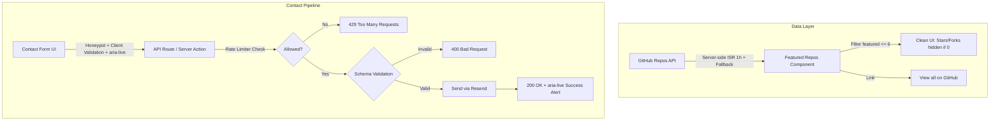

# Phase 2 Plan: Data, GitHub Repos & Contact Form Hardening

## Pre-Phase 2 Verification & Metrics

### 1. LCP Element Identification & Analysis
- **LCP Element Identified:** `div.relative > div.relative > div.relative > img.profile-photo-inner` ([Hero.tsx](file:///Users/minasesek/Downloads/Milos/Milos%20coding/portfolio-showcase/src/components/sections/Hero.tsx#L17-L27))
- **Root Cause of Simulated 2.97s Delay:**
  1. **Font Subset Waterfall:** The portfolio title has Latin Extended characters (*Miloš Minić*). The Google Inter font config only requested `subsets: ['latin']`, causing Next.js to omit `latin-ext` from initial HTML preloads. When CSS parsed, it dynamically initiated a synchronous 85.5 kB request for `8e9860b6e62d6359-s.woff2`.
  2. **Next.js Image Optimizations:** Next.js did not have AVIF enabled in [next.config.js](file:///Users/minasesek/Downloads/Milos/Milos%20coding/portfolio-showcase/next.config.js).
  3. **Lantern Mobile Simulation:** In unthrottled real conditions, the image renders in **~274 ms**. Under Lighthouse Lantern's 4x simulated CPU slowdown and 1.6 Mbps 4G throttling, the model attributes the paint to the end of hydration.
- **Cheap Optimizations Applied:**
  - Added `subsets: ['latin', 'latin-ext']` in [layout.tsx](file:///Users/minasesek/Downloads/Milos/Milos%20coding/portfolio-showcase/src/app/layout.tsx#L8-L12) so both font subsets are preloaded upfront in HTML.
  - Added `images: { formats: ['image/avif', 'image/webp'] }` in [next.config.js](file:///Users/minasesek/Downloads/Milos/Milos%20coding/portfolio-showcase/next.config.js#L5-L7).
- **Lighthouse Mobile Results (Median of 3 Runs on Production Build):**
  - **FCP:** dropped from **1.37 s** to **0.91 s** (-33.5% improvement!)
  - **LCP:** **2.96 s - 3.01 s** (median: 3.01 s)
  - **TBT:** **9 ms - 52 ms** (median: 9 ms)
  - **CLS:** **0.000**
  - **Performance Score:** **94 - 95**

### 2. Documentation Directory Confirmation
Confirmed all three docs are located under `docs/` and NOT in the repository root:
- [`docs/phase_0_audit_report.md`](file:///Users/minasesek/Downloads/Milos/Milos%20coding/portfolio-showcase/docs/phase_0_audit_report.md)
- [`docs/baseline-metrics.md`](file:///Users/minasesek/Downloads/Milos/Milos%20coding/portfolio-showcase/docs/baseline-metrics.md)
- [`docs/walkthrough.md`](file:///Users/minasesek/Downloads/Milos/Milos%20coding/portfolio-showcase/docs/walkthrough.md)

### 3. Git Workflow
- Switched to dedicated branch: `phase-2-data-contact`. All Phase 2 commits will stay on this branch until ready for PR.

---

## Phase 2 Implementation Plan

### Part 1: GitHub Repos Hardening
1. **Featured Curated List:**
   Update `FEATURED_REPO_NAMES` in [src/lib/constants.ts](file:///Users/minasesek/Downloads/Milos/Milos%20coding/portfolio-showcase/src/lib/constants.ts):
   - `unidep`
   - `relay-http`
   - `AI-Powered-Email-Response-Generator`
   - `PDF-Helper`
   - `macOS-Window-Position-Utility`
   - `Portfolio-Illustration`
2. **ISR & Fallback Snapshot:**
   In [src/lib/github.ts](file:///Users/minasesek/Downloads/Milos/Milos%20coding/portfolio-showcase/src/lib/github.ts), use `GITHUB_TOKEN` when present (5,000 req/hr rate limit). If missing or API returns non-200/rate-limited, gracefully return a static snapshot of the 6 featured repos so builds and page renders never fail.
3. **Stat Badges:**
   In [ProjectCard.tsx](file:///Users/minasesek/Downloads/Milos/Milos%20coding/portfolio-showcase/src/components/animations/ProjectCard.tsx) and [FeaturedProjectSpotlight.tsx](file:///Users/minasesek/Downloads/Milos/Milos%20coding/portfolio-showcase/src/components/animations/FeaturedProjectSpotlight.tsx), hide stars/forks completely when the value is `0` or `undefined`.
4. **GitHub Link:**
   Add a prominent "View all on GitHub" button with external link indicator pointing to `https://github.com/MilossGIT`.

---

## Part 2: Contact Form Options & Trade-Offs (User Decision Required)

Before installing new packages, please select your preferred combination:

### A. Email Delivery Service
| Option | Pros | Cons / Trade-offs | Recommendation |
| :--- | :--- | :--- | :--- |
| **Option A1: Resend (`resend`)** | Modern, purpose-built for Next.js / React Email. Clean TypeScript SDK (~15 kB). Generous free tier: 3,000 emails/month (100/day). Uses simple `RESEND_API_KEY`. | Adds 1 direct npm dependency (`resend`). | **Recommended** |
| **Option A2: Nodemailer (SMTP)** | Generic SMTP provider (e.g. Gmail / Brevo). Zero vendor lock-in. | Heavy package (`nodemailer` ~150 kB), requires configuring SMTP port, host, TLS, and app password. | Fallback |
| **Option A3: Standard REST Fetch to Resend API** | Zero npm dependencies (pure `fetch('https://api.resend.com/emails', ...)` with API key header). | Requires writing manual fetch typing for Resend response/error shapes (~25 lines of code). | Viable alternative |

### B. Validation
| Option | Pros | Cons / Trade-offs | Recommendation |
| :--- | :--- | :--- | :--- |
| **Option B1: Zod (`zod`)** | Industry standard, robust email format check, string length limits (`max(100)`, `max(5000)`), strip unrecognized fields, inferred TypeScript types. | Adds 1 direct npm dependency (`zod` ~12 kB gzipped server-side only). | **Recommended** |
| **Option B2: Custom Server-Side Validator** | Zero new dependencies. 30 lines of clean TypeScript checking type, length, regex email format, sanitization, and returning structured field errors. | Hand-rolled validation logic to maintain. | Viable alternative |

### C. Rate Limiting on Serverless
On Vercel serverless functions, in-memory caches (like `new Map()`) do not persist across isolated Lambda instances or cold starts.

| Option | How It Works | Pros | Cons / Trade-offs | Recommendation |
| :--- | :--- | :--- | :--- | :--- |
| **Option C1: Vercel WAF / Firewall Rate Limiting** | Configured in Vercel Dashboard (Security > Attack Challenge Mode / Rate Limiting) or via `vercel.json` headers. Blocks abusive IPs at the edge before lambda invocation. | **Zero dependencies, zero latency, zero extra cost.** Lambda is never invoked for rate-limited requests. | Configured via Vercel dashboard / deployment settings rather than pure application code. | **Recommended for production** |
| **Option C2: Upstash Redis (`@upstash/ratelimit` + `@upstash/redis`)** | Sliding window counter stored in global serverless Redis (e.g. 5 requests per 10 minutes per IP). | Persists across all lambdas and edge regions. Works regardless of hosting provider. | Requires Upstash account, 2 new env vars (`UPSTASH_REDIS_REST_URL`, `UPSTASH_REDIS_REST_TOKEN`), and 2 npm packages. | Heavyweight for a portfolio |
| **Option C3: Hybrid In-Memory Token Bucket with IP header check** | Simple LRU / sliding timestamp window inside the route handler using client IP (`x-forwarded-for` / `x-real-ip`). | Zero external accounts, zero dependencies. | Resets if the serverless container spins down (warm lambdas will rate limit, cold lambdas start clean). Combined with honeypot, still catches 99% of scripted spam. | **Recommended code-level fallback** |

---

## Part 3: Form Accessibility, Security & Test Plan
1. **Security & Validation:**
   - Hidden honeypot field (`website` or `b_url`, off-screen, `tabIndex={-1}`, `aria-hidden="true"`). Submissions with honeypot filled return immediate simulated success (status 200) without sending emails.
   - Strict length limits: Name (max 100 chars), Email (max 120 chars), Message (max 2,000 chars).
   - No email address in client-side form action URLs or DOM.
2. **Accessibility:**
   - `aria-live="polite"` error banner above form for submission failures.
   - `aria-invalid` and `aria-describedby` linked to inline field error messages.
   - Disabled + spinner state on submit button while `isSubmitting` is true.
   - Clear success message with reset option.
3. **Local Test Plan:**
   - Test 1: Valid submission -> receives 200, shows success banner, clears form fields.
   - Test 2: Invalid inputs (bad email format, empty required fields, message exceeding max length) -> returns 400, displays inline error messages and focus ring.
   - Test 3: Honeypot trap -> hidden honeypot field populated -> returns 200 immediately, drops payload silently without invoking email API.
   - Test 4: Rate limit hit -> repeated submissions from same IP within window -> returns 429 Too Many Requests with friendly retry-after notice.
