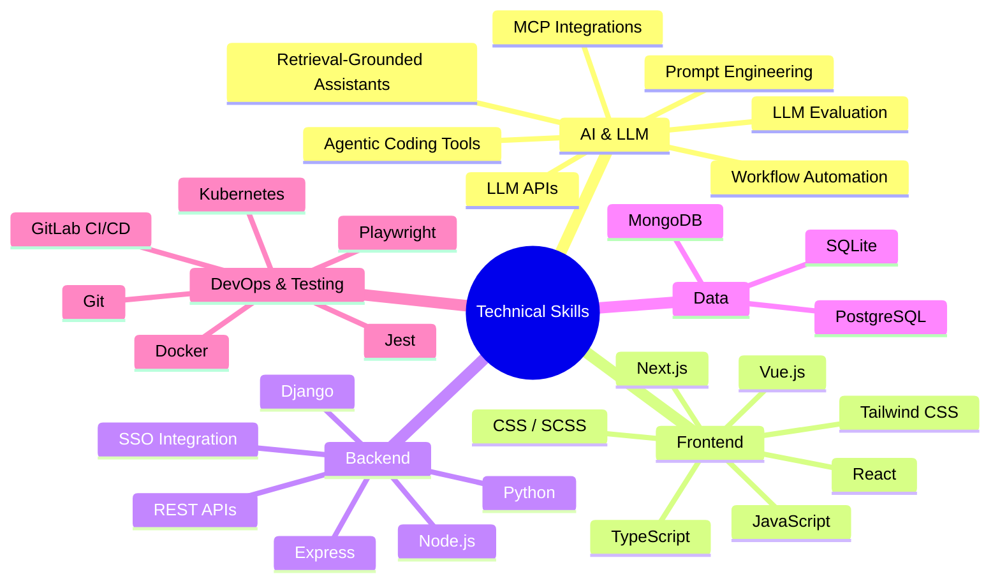

# Phase 3 Implementation Plan: Content, Case Studies & UX Structure

## Goal Description
Implement Phase 3 on branch `phase-3-content`:
1. **Work Cards:** Add optional screenshot slot (`next/image`, responsive `sizes`, placeholder) and "role and outcome" line. Render image ONLY when a valid file path exists; never show empty/broken image placeholders.
2. **AI Case Studies Component:** Create `CaseStudies.tsx` for AI work at Sportradar with structured sections: Problem, Approach, Stack, Result. Keep details anonymized. Metrics fields remain hidden until filled in.
3. **Profile Section Refinement:** Replace the long paragraph in `About.tsx` with a one-sentence pitch plus 3 scannable highlights (copy proposed below for user approval).
4. **Skills Grouping & Pruning:** Group into 5 clean categories: `AI / LLM`, `Frontend`, `Backend`, `Data`, `DevOps & Testing`. Prune generic filler skills (`HTML5`, `Agile`, `Responsive Design`).
5. **Experience Section:** Show latest 3 roles expanded; collapse earlier roles into a compact list using native `<details>`/`<summary>` (zero-JS, keyboard-accessible).
6. **CV Download Button:** Add "Download CV" button that renders only when `public/cv.pdf` exists on disk.
7. **Label Fixes & Card Name:** Fix duplicated "Get in touch" label between Navbar and Hero; verify ZKH card is named `Standardi Hipnoterapije` to match `standardi-hipnoterapije.org`.

---

## 1. Proposals for User Approval

### A. Profile Section Copy (About.tsx)
Replacing the monolithic 4-sentence paragraph with:

> **Pitch:**
> *"Product engineer with 10+ years of web development experience, building intuitive frontend products and AI tools that automate real-world engineering workflows."*
>
> **Highlights:**
> 1. **AI & Workflow Automation:** Designed retrieval-grounded knowledge assistants with source citations and automated multi-system runbooks across GitHub, Slack, and Jira (100+ automated runs).
> 2. **Production Systems & Evaluation:** Deployed containerized Node.js services behind company SSO on Kubernetes, protected by Playwright test suites and automated LLM evaluation checks in CI.
> 3. **Full-Lifecycle Product Delivery:** Taking digital products from initial architecture to production using TypeScript, React, Next.js, and LLM APIs with an uncompromising bar for UX, performance, and accessibility.

---

### B. Skills Grouping & Proposed Removals



#### Proposed Removals (Filler / Generic Baseline):
- `HTML5`: Assumed baseline for any senior web engineer.
- `Agile`: Process buzzword rather than technical skill.
- `Responsive Design`: Baseline CSS capability, already represented by Tailwind/CSS.
- `MySQL`: Consolidate relational DBs to PostgreSQL and SQLite.

---

### C. Case Studies Structure (Sportradar AI Work)

```tsx
interface CaseStudy {
  id: string
  title: string
  subtitle: string
  problem: string
  approach: string
  stack: string[]
  result: string
  metrics?: { label: string; value: string }[] // Omitted/hidden until filled
}
```

1. **Retrieval-Grounded Knowledge Assistant**
   - **Problem:** Technical specs, API schemas, and integration FAQs were distributed across disconnected documentation silos, creating high support overhead for repeated queries.
   - **Approach:** Engineered a knowledge retrieval assistant with strict source grounding and direct citations, enabling engineers to instantly verify referenced documentation.
   - **Stack:** `TypeScript`, `Node.js`, `LLM APIs`, `Embeddings / Vector Search`, `React`
   - **Result:** Shipped behind company SSO on Kubernetes, providing verifiable answers with clickable source citations.
2. **Multi-System Runbook & Incident Automation**
   - **Problem:** Routine operational tasks and client onboarding workflows required manual, error-prone coordination across GitHub, Slack, and Jira.
   - **Approach:** Built automated runbook workflows integrating GitHub events, Slack notifications, and Jira issue tracking into cohesive end-to-end automation pipelines.
   - **Stack:** `Node.js`, `TypeScript`, `GitHub API`, `Slack API`, `Jira API`, `Docker`
   - **Result:** Executed 100+ automated runs, eliminating repetitive manual setup steps for engineering and support teams.
3. **Internal AI Infrastructure & CI Evaluation**
   - **Problem:** Deploying internal AI tooling required enterprise access controls, high availability, and regression testing for prompt changes.
   - **Approach:** Packaged services in Docker containers, deployed behind enterprise SSO on Kubernetes, and integrated Playwright end-to-end testing with automated LLM output evaluation in GitLab CI.
   - **Stack:** `Kubernetes`, `Docker`, `SSO / OAuth`, `Playwright`, `GitLab CI/CD`, `LLM Evaluation`
   - **Result:** Production service running reliably with usage metrics, Slack feedback mechanisms, and CI evaluation preventing regressions.

*Note displayed on card:* *"Details and internal system names are anonymized to protect company confidentiality."*

---

### D. Work Cards (WorkHighlights.tsx)
- Add optional `image?: string` to `WORK_HIGHLIGHTS`.
- When `work.image` is provided: renders `next/image` with `sizes="(max-width: 768px) 100vw, 50vw"` and blur/color placeholder.
- When `work.image` is undefined: renders clean card without blank image container.
- Add `role?: string` and `outcome?: string` line to each project card:
  - **Kind Cadence:** Role: Product Engineer (Solo) · Outcome: Deployed mobile readiness coach integrating Strava and biometric data.
  - **Lokacija.net:** Role: Full-Stack Engineer · Outcome: Production Django/PostgreSQL real-estate search portal for Slovenia and the Adriatic region.
  - **Ormarich:** Role: Frontend & Integration Engineer · Outcome: Production Next.js storefront with Stripe checkout and webhook inventory synchronization.
  - **Standardi Hipnoterapije:** Role: Frontend Engineer · Outcome: Trilingual association portal on Next.js and Payload CMS with DeepL automated translation workflow.

---

### E. CV Download Button & Label De-duplication
1. **CV Button:** Server Component helper checks `fs.existsSync(path.join(process.cwd(), 'public/cv.pdf'))`. If true, renders "Download CV" button. If false, renders nothing.
2. **De-duplicate "Get in touch":**
   - Navbar CTA: change to **"Contact"** (clean, standard header CTA).
   - Hero primary button: keep **"Get in touch →"**.
   - Contact section header: keep **"Get in Touch"**.

---

## Verification Plan

### Automated Checks
```bash
npm run lint && npm run build
```
- First Load JS must remain <= 113 kB.
- No client component inflation (CaseStudies and WorkHighlights are Server Components).

### Content Invisibility Check
- Verify `public/cv.pdf` absence -> confirm no broken CV button renders.
- Verify `metrics` absence -> confirm no empty metrics containers render.
- Verify missing screenshots -> confirm no empty gray image boxes render.
